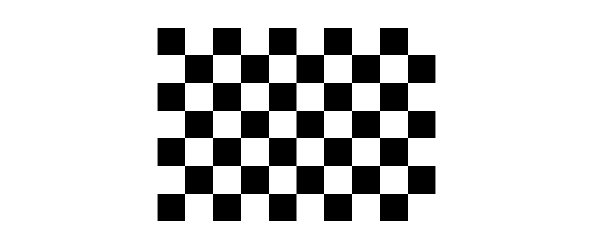
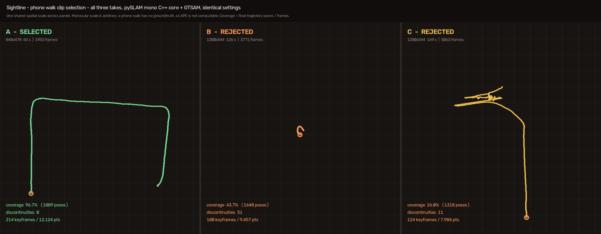

# Andromeda

**GPS-denied UGV navigation with visual SLAM.** Andromeda is a hardware-free proof of concept for search-and-rescue, agriculture, and delivery scenarios where GPS is unavailable or unreliable.

It demonstrates two complementary tracks:

- **Real-image perception:** monocular pySLAM reconstructs a sparse map and camera trajectory from phone footage.
- **Simulated autonomy:** Gazebo, RTAB-Map, and Nav2 build an occupancy grid and navigate a TurtleBot3 to a goal without GPS.

> The tracks are intentionally separate: the phone map has arbitrary monocular scale and is not fed into the Gazebo/Nav2 map.

## Results

| Evaluation | Result |
|---|---:|
| KITTI 06 visual-SLAM APE RMSE | **49.5 m** after Umeyama Sim(3) alignment (**4.05%** of a 1,222 m path) |
| KITTI frames tracked | **1,101 / 1,101** |
| Sparse map | **321 keyframes**, **11,893 points**, 0 resets |
| Simulated navigation final error | **0.21 m**, within Nav2 tolerance |
| Navigation recoveries | **3**, recorded and surfaced rather than hidden |

Monocular SLAM has no metric scale, so KITTI is used for trajectory-error evaluation. Phone-walk footage has no ground truth and is reported only as tracking-survival evidence.

## Media

| Calibration capture | Phone-walk clip selection |
|---|---|
|  |  |

Recorded demonstrations: [phone visual SLAM](media/phone_walk_slam_demo.mp4) · [sparse 3D map](media/phone_walk_map_3d.mp4) · [KITTI ground-truth comparison](media/kitti06_gt_demo.mp4)

## Quick start

```bash
docker build -t ugv-slam:demo docker/
./scripts/run_demo.sh
```

Inside the container, run `./scripts/check_gpu.sh` before Gazebo; it must report the NVIDIA renderer. For the full demo and recovery ladder, use `./scripts/demo_day.sh --check` and see [RUNBOOK.md](RUNBOOK.md).

## Documentation

- [Project documentation](docs/README.md)
- [Internal engineering notes](internal-docs/README.md)
- [Specification and decisions](SPEC.md)
- [Detailed runbook](RUNBOOK.md)

## Scope

The simulation is GPS-denied but not purely camera-only: RTAB-Map uses RGB-D data and Gazebo wheel odometry. Simulated depth is noise-free, and real-hardware terrain/light robustness remains future work.

# Team Members
Team Andromeda
- Ishita Bhatt
- G Sai Prashanth
- Akshit B
- Ahana Khan
- Sanya Tripathi
- Hasveel Singh

# License
MIT licensed; local pySLAM patches remain subject to pySLAM's GPLv3 terms.